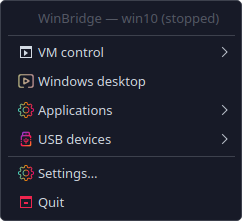
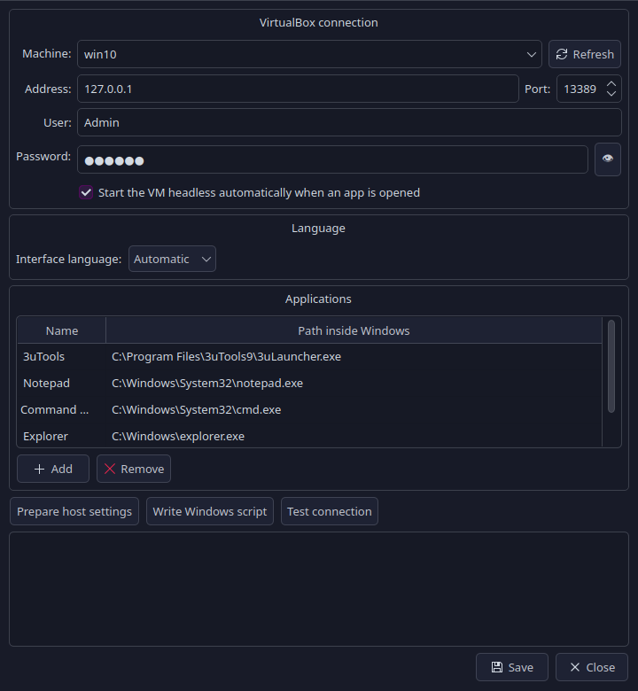
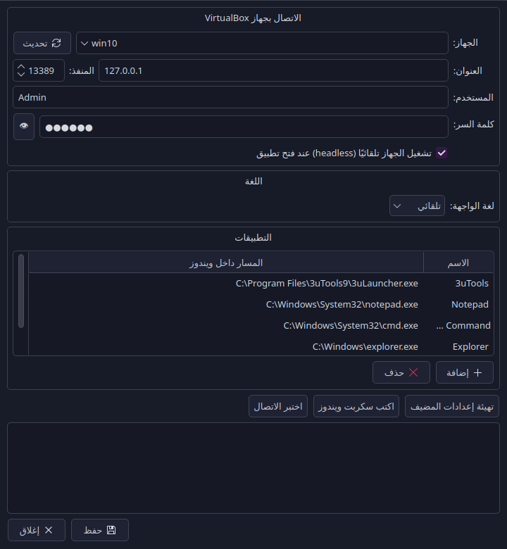

# WinBridge

Run **Windows applications from a VirtualBox VM as if they were native Linux
windows** — no full desktop in the way, no proprietary cloud, no patched
`termsrv.dll`. WinBridge is a small, hackable, MIT-licensed alternative to
WinBoat / WinApps that plugs into a Windows VM **you already have**.

The interface is available in **English and Arabic** (RTL-aware). The language
follows your desktop locale automatically and can be changed at any time in
*Settings → Language*.

---

## How it works

```
┌─────────────────────────── Linux ───────────────────────────┐
│  WinBridge (tray / CLI)                                     │
│      │  VBoxManage          │  xfreerdp3                     │
│      ▼                     ▼                                │
│  VirtualBox  ──NAT 127.0.0.1:13389──►  3389 (Windows RDP)   │
│                                   │                         │
│                                   └─ RAIL → single app window
└─────────────────────────────────────────────────────────────┘
```

1. **Host settings** — adds a NAT port-forward (`127.0.0.1:<port>` → guest
   `3389`), enables the VM's USB controller and boots it headless.
2. **Guest settings** — a generated `winbridge-setup.cmd` enables Remote
   Desktop, disables NLA (so plain TLS works even on hosts with a broken
   Kerberos config), opens the firewall and sets
   `TSAppAllowList\fDisabledAllowList=1` so **any** executable can be
   published as a RemoteApp.
3. **Running apps** — FreeRDP connects with `/app:program:...` (RAIL), so only
   the application window is streamed and it behaves like a normal X11/Wayland
   window: taskbar entry, alt-tab, clipboard, window manager decorations.

**Security mode is negotiated automatically.** A stock Windows only accepts NLA,
while a guest prepared by `winbridge-setup.cmd` accepts plain TLS. WinBridge
tries NLA first, falls back to TLS when the guest refuses it, and remembers the
mode in `config.json` (`"security": "nla" | "tls" | "auto"`). If Windows changes
its settings later, the next attempt renegotiates.

Nothing listens on an external interface: the port forward is bound to
`127.0.0.1`. Because of that the RDP certificate is not verified either — Windows
generates a new self-signed certificate on every installation, so pinning it
would break the first connection after a reinstall.

## Screenshots

| English | العربية |
|---|---|
|  |  |
|  |  |

## Features

- 🖥️ Full Windows desktop in one window, or **one window per app (RAIL)**.
- 🔌 **USB passthrough from the tray** — plug/unplug any host device into the
  VM with a checkbox; state (`Captured`) is read back from VirtualBox.
- ⚡ **VM power controls** — start headless, start with GUI, shut down,
  restart, or open the VM console directly from the tray menu.
- 🚀 Auto-starts the VM headless when you open an app, so the tray icon is all
  you need.
- 🧩 App list stored in `~/.config/winbridge/config.json` (name → Windows path).
  `explorer` (File Explorer / *This PC*) works out of the box, as does any
  `.exe` path you add.
- 🌍 **English + Arabic interface** with automatic RTL layout; pick a language
  in Settings or force one with `WINBRIDGE_LANG=en|ar`.
- 🔐 Credentials stay local; config file is `chmod 600`.
- 🩺 `winbridge doctor` checks every dependency and connection state.
- 🧱 No kernel patches, no RDPWrap, no reverse-engineered binaries.

## Requirements

| Component | Package (Arch/CachyOS) | Notes |
|---|---|---|
| VirtualBox | `virtualbox virtualbox-host-modules-arch` | any recent 7.x |
| FreeRDP 3 | `freerdp` | provides `xfreerdp3` |
| Python + Qt | `python` + `pyside6` (or the bundled venv) | PySide6 ≥ 6.4 |
| Windows VM | Windows 10/11 **Pro/Enterprise** | Home cannot host RDP |

Optional, for USB 2.0/3.0 devices (phones, iPhones, cameras):

- **Oracle VM VirtualBox Extension Pack** (PUEL licence) matching your
  VirtualBox version. Without it the VM only gets a USB 1.1 (OHCI) controller
  — keyboards/mice/serial adapters work, phones usually do not.

## Install

```bash
git clone https://github.com/Malek-Haroun512/winbridge.git && cd winbridge
./install.sh          # user-level: venv in ~/.local/share/winbridge
winbridge doctor      # sanity check
winbridge tray        # icon appears in the system tray
```

`install.sh` never uses `sudo`. It creates an isolated venv, a
`~/.local/bin/winbridge` launcher, a `.desktop` entry and installs the icon.

## First-time setup

1. **Create/choose a VM** in VirtualBox with Windows 10/11 Pro and Guest
   Additions. Boot it once and create your user (or let WinBridge use an
   existing one).
2. **Open WinBridge → Settings**, pick the VM, fill user/password (the same
   Windows account), press **Prepare host settings**. This powers the VM off,
   adds the NAT rule, enables USB, boots it headless and writes
   `~/.config/winbridge/winbridge-setup.cmd`.
3. **Inside Windows** copy that `.cmd` in, right-click → *Run as
   administrator*, wait for `3389 … LISTENING`.
4. Back in Settings press **Test connection**. Then open an app from the tray.

Add the apps you want in **Settings → Applications** (name + `C:\full\path.exe`).
They show up in the tray menu and can be launched from the CLI:

```bash
winbridge app 3utools
winbridge app 'C:\Program Files\Some App\app.exe'
winbridge app explorer
winbridge desktop
```

## USB passthrough

Tray icon → **USB devices** → tick a device to attach, untick to detach.

```bash
winbridge usb list
winbridge usb attach 04e8:6860
winbridge usb detach "SAMSUNG_Android"
```

The list is refreshed from `VBoxManage list usbhost` every time the menu
opens. A device that is already `Captured` is shown with `✓`.

> USB 2.0/3.0 needs the Extension Pack. WinBridge detects it and falls back to
> OHCI, showing a warning in the menu instead of failing silently.

## Language

- Default: follow the desktop locale (`LANG` / `LC_ALL`), falling back to
  English.
- *Settings → Language*: **Automatic**, **English**, or **العربية**.
- Override for one run: `WINBRIDGE_LANG=ar winbridge tray`.
- Arabic switches the whole UI (tray menu, settings dialog, CLI output) to
  right-to-left.

## Autostart (optional)

```bash
mkdir -p ~/.config/autostart
cp ~/.local/share/applications/winbridge.desktop ~/.config/autostart/
```

## Troubleshooting

| Symptom | Fix |
|---|---|
| `HYBRID_REQUIRED_BY_SERVER` | Stock Windows requires NLA. WinBridge 0.1.1+ negotiates it on its own; on older versions rerun the guest script (it disables NLA) or upgrade. |
| `Kerberos … ATHENA.MIT.EDU` in logs | Harmless: NLA falls back to NTLM. The guest script can disable NLA entirely so plain TLS is used. |
| `RAIL_EXEC_E_NOT_IN_ALLOWLIST` | `fDisabledAllowList` not applied — rerun the guest script as Administrator. |
| Window never appears but the app runs | Windows client SKUs allow **one** interactive session. WinBridge closes the previous FreeRDP client and resumes the same Windows session, so all previously opened app windows come back. If nothing shows up, run `winbridge doctor` and check `~/.local/state/winbridge/freerdp.log`. |
| `No system tray available` | Your desktop needs a StatusNotifierItem host (KDE/GNOME with AppIndicator extension). |
| VM won't power off for host setup | Shut it down from VirtualBox, then run *Prepare host settings* again. |
| Nothing opens on a freshly installed Windows | Windows resets RDP, NLA, the firewall and the RemoteApp allowlist. Run *Prepare host settings* and then `winbridge-setup.cmd` as Administrator inside the new install. |
| App windows never appear but the desktop works | The RemoteApp allowlist is on: run `winbridge-setup.cmd` as Administrator (`fDisabledAllowList=1`). |
| Session drops right after connecting | Windows allows one interactive session. Sign out inside the VirtualBox window (or close it) before opening apps from the tray. |
| Text renders in the wrong direction | Set the language explicitly in *Settings → Language* instead of *Automatic*. |

Logs: `~/.local/state/winbridge/freerdp.log` and `journalctl --user`.

## Development

```bash
python3 -m winbridge doctor
python3 -m winbridge tray
python3 -m pip install -e .   # editable install
```

Layout:

```
winbridge/
├── config.py          # JSON config (~/.config/winbridge)
├── i18n.py            # English/Arabic strings, RTL flag
├── vbox.py            # VBoxManage wrapper (VMs, NAT, USB)
├── rdp.py             # FreeRDP command builder + launcher
├── setup_guest.py     # host prep + generated Windows script
├── tray.py            # QSystemTrayIcon UI
├── settings_window.py # Qt settings dialog
└── __main__.py        # CLI
```

Adding a language: copy the `_EN` table in `i18n.py`, translate the values, and
register the code in `LANGUAGES` / `TRANSLATIONS`.

## License

MIT — see [LICENSE](LICENSE). Copyright © 2026 **Malek Haroun**.

VirtualBox is Oracle's; the Extension Pack is PUEL-licensed and is *not*
redistributed here.
